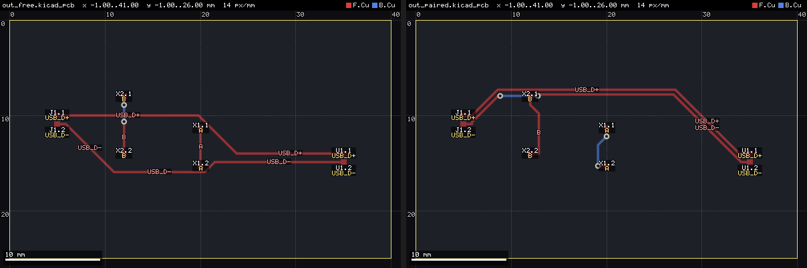
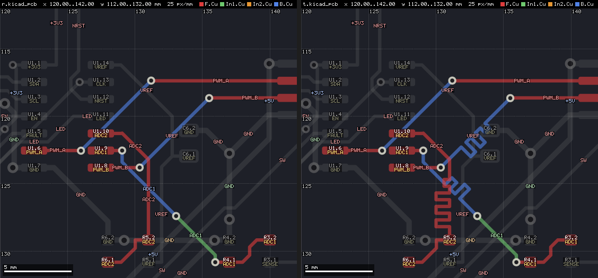
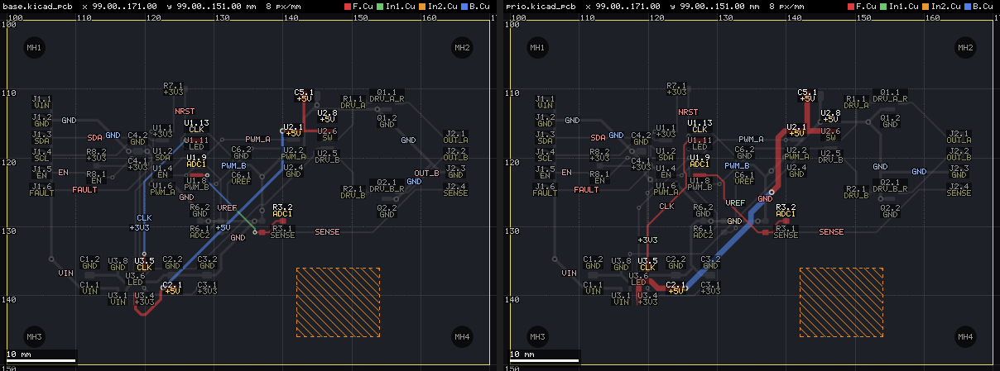
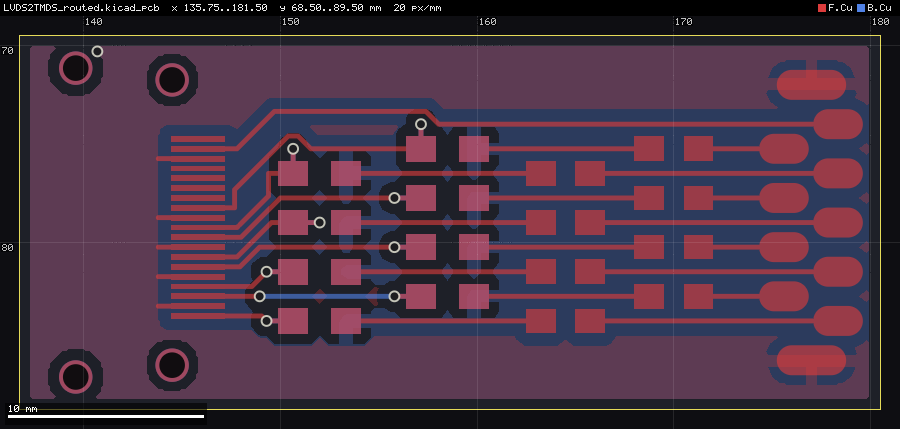
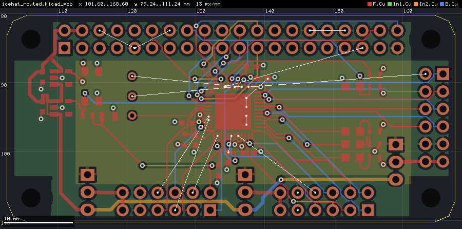
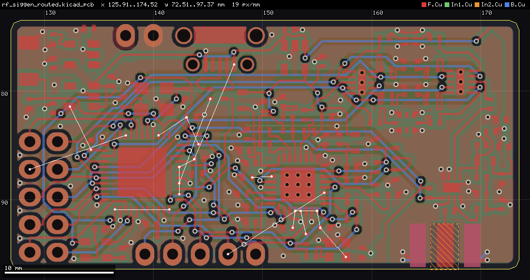
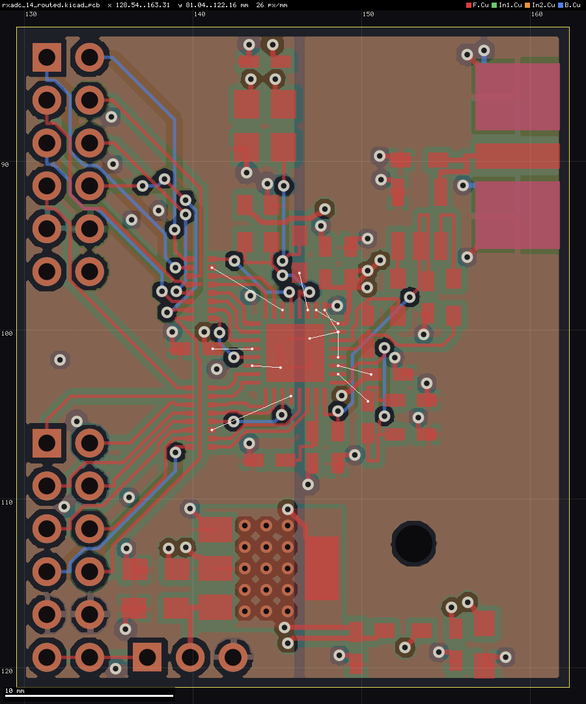
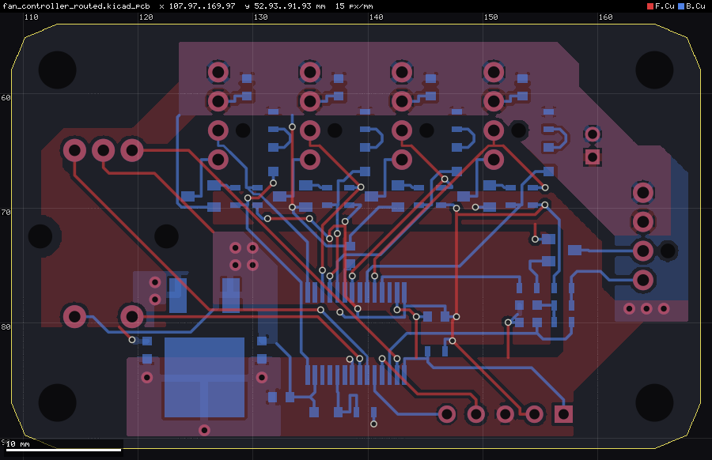
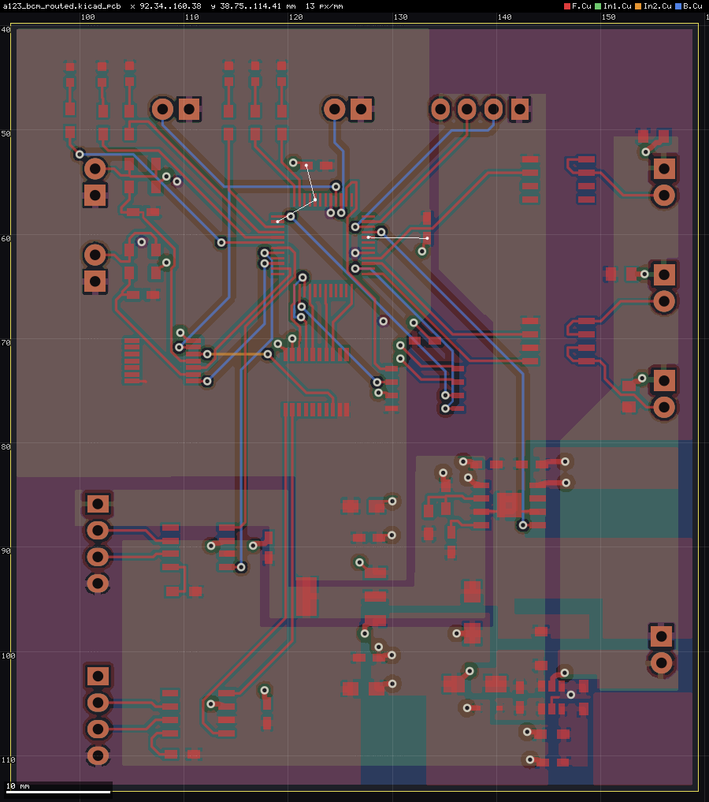

# copperpath

Rule-aware routability check, placement helper and grid router for **already-placed KiCad boards**,
written in Rust (parallel with rayon). It reads the board, the net classes (`.kicad_pro`) and the
custom rules (`.kicad_dru`) directly, routes signal nets with exact clearance checks and writes the
result back as ordinary KiCad tracks and vias.

**Status: research prototype.** Tested on KiCad 10 boards (2, 4 and 6 copper layers). Expect
rough edges; see [Limitations](#limitations) and [ROADMAP.md](ROADMAP.md).


At a glance (every command takes `--json`; times on 4 cores):

| | |
|---|---|
| **One-shot routing** | `autoroute`: planes, fanout, signals, pours, thermal fixes and a DRC gate in one call; 2 of 8 PCBench boards fully routed, the others with 1-11 % of their connections left open ([benchmark](#benchmark-pcbench)) |
| **Routing intents per net** | `low_r`, `wide`, `low_l`, `short`, `few_vias`, `quiet`, `first`, `outer`, `z:OHM` (impedance width from the stackup), `pair` (differential pairs); from `--prio`, the project file or the net class name ([intents](#routing-intents-per-net---prio)) |
| **Length matching** | `tune --match 'D[0-7]'`: exact-length accordion meanders, clearance-checked |
| **Native DRC** | the copper checks of `kicad-cli pcb drc` with KiCad's semantics in 7-105 ms instead of 0.7-1.8 s ([DRC](#native-drc-drc)) |
| **For agents** | `status` (overview, suggested intents, next commands) in milliseconds, `explain` (why a net is open), `ripup` + `route --nets` (redo a net in about a second), `netinfo` (R, L, Z0, coupling, bus skew); [a recorded session](docs/agent-session.md) |

## Numbered net compatibility

KiCad 6–9 boards use a numbered net table; KiCad 10 references nets by name. CopperPath now resolves numbered pads, tracks, vias and zones to their real names, validates code/name consistency, and preserves the input net-reference format when routing, applying deltas or creating planes. This fixes routed KiCad-9 output containing invalid quoted numeric net references. Named numeric strings on KiCad-10 boards remain names. Complete compatibility with every older KiCad feature is not implied.

The agentic-eda divider integration independently checks the routed output with KiCad 9 DRC and exports Gerbers; `tests/numbered_nets.rs` covers non-contiguous codes, malformed tables, delta application and roundtrip routing. Existing named-net tests remain required.

## Build

Requires a recent stable Rust toolchain (developed with 1.95).

```bash
cargo build --release          # binary: target/release/copperpath
cargo test --release           # unit tests + routing of the demo board
```

Optional: KiCad 10's `kicad-cli` for the DRC comparison (`route --drc`). It is found via
`--kicad-cli PATH`, else `$KICAD_CLI`, else `kicad-cli` on the `PATH`.

## Quickstart (demo board)

`examples/demo/` holds a small synthetic 4-layer board (25 parts, 24 nets, one rule area, two net
classes, three custom rules), placed but not routed.

```bash
B=target/release/copperpath
$B route --pcb examples/demo/demo.kicad_pcb --out out/demo_routed.kicad_pcb --threads 4
#   [route] 24 nets, 50 connections: 189 segments (604 mm), 29 vias ... 0 opens
$B route --pcb examples/demo/demo.kicad_pcb --out out/demo_routed.kicad_pcb --drc --json
#   {"ok": true, "opens": 0, "vias": 29, "drc": {"new_errors": 0, ...}, ...}
$B check --pcb examples/demo/demo.kicad_pcb --out out/check     # routability report + PNG maps
$B hints --pcb examples/demo/demo.kicad_pcb                      # placement hints
```

Open `out/demo_routed.kicad_pcb` in KiCad. The input board is never modified.

## Commands

All commands take `--pcb BOARD.kicad_pcb`. Common options:

| option | meaning |
|---|---|
| `--cfg config.json` | optional board configuration (see `examples/config.json`) |
| `--board NAME` | entry under `"boards"` in the config (default: the first) |
| `--pro F` / `--dru F` | project / custom rules file (default: next to the board) |
| `--threads N` | worker threads (default: all cores) |
| `--json` | one JSON result object on stdout; logs stay on stderr |
| `--version` | version and git hash |

| command | job |
|---|---|
| `route [--region x0,y0,x1,y1] [--nets PATTERNS] --out OUT.kicad_pcb [--delta-json DELTA.json] [--drc]` | Detailed router (below). Routes every routable net whose pads lie in the region (default: whole board). Appends unlocked tracks/vias to a copy and writes `OUT_route.json`; `--delta-json` writes the added/removed items in nm for the KiCad IPC API ([schema](#change-set-for-the-kicad-ipc-api---delta-json)). `--drc` runs `kicad-cli` on input and output and reports the new violations. |
| `check [--out DIR] [--res 0.25] [--tile 1.0] [--copper locked\|all] [--crop x0,y0,x1,y1 --crop-class C]` | Routability report: via-site maps per net class, region analysis per schematic sheet, what-if ablation (without rule areas, via keepouts, locked copper), global route with congestion per tile and layer, hotspot list. Writes `report.json`, `groute.json`, `congestion.json` and PNG maps. |
| `place --zones zones.json [--init keep\|schematic\|both] [--moves N] [--starts K] [--out DIR]` | Parallel simulated-annealing placement of the movable parts inside zones (see `examples/zones.json`). Writes `place.json`; apply it to a copy with `scripts/apply_place.py`. |
| `tune --match REGEX [--target MM] [--gap MM] [--amax 1] --out OUT` | Length matching: accordion meanders on straight tracks bring every matching net to the target length (default: the longest of them); each bump adds twice its amplitude, the last one the remainder, so the target is met exactly; every new segment keeps the clearances to other nets' copper, holes, rule areas and the board edge. `--json`: length before/after and meanders per net. |
| `thermals --out OUT` | Refills the zones natively and gives every starved thermal pad (fewer than 2 resolved spokes, counted as kicad-cli 10 does: spokes into isolated islands only count when nothing else does, a track from the pad into the fill counts) a short legal stub track into its zone's fill, preferring fill connected to other items. `--json`: starved pads and stubs added. |
| `ripup --nets PATS [--region BOX] [--locked] --out OUT` | Removes the unlocked tracks and vias of the matching nets (with `--locked` the locked ones too), optionally only those touching a region; `--json` lists what was removed per net. With `route --nets` an agent redoes single nets in well under a second. |
| `status [--refill-zones]` | One-call overview for agents, in milliseconds: copper stack, net classes, zones with their selection key, plane nets and candidates, opens per net, native DRC by type, routing intents suggested from the net names (`suggested_prio`: supply rails `wide`, clocks `low_l`, RF `z:50+outer`, analog `quiet`), and the next commands to run (`--json`: `next`). |
| `netinfo [--nets] [--cu-um 35]` | Length, vias, track width and estimated DC resistance (mΩ) and inductance (nH) per net, in milliseconds. See [Routing intents](#routing-intents-per-net---prio). |
| `drc [--refill-zones] [--out report.json]` | Native copper DRC with KiCad's rule names in milliseconds. See [Native DRC](#native-drc-drc). |
| `opens [--region] [--nets] [--max-islands 50]` | Unconnected connections per net, counted from all copper including saved zone fills (no 499-item cap as in kicad-cli). Nets named in `--nets` are counted even if they are plane nets. `--json` lists the islands of each open net (pads per copper component, largest first). |
| `hints [--region] [--nets] [--tol 1.0]` | Pad pairs of a net that are *almost* in one row or column (offset 0.02..tol mm). Each forces a jog between two straight pad exits; align the pads before routing. |
| `stitch --net GND --zones REGEX --plane REGEX [--grid G] --out OUT.kicad_pcb` | Stitching vias for a plane net from the saved zone fills: one via in every fill island of the `--zones` zones (zone name, full match; an unnamed zone matches as `NET@LAYER`, e.g. `GND@In1.Cu`) that has no via or plated hole of the net, optionally a via grid of pitch G per island. A via must lie on a fill of a `--plane` zone of the same net (fully on its copper), keep the DRU/net-class clearance to every other net on every layer (outer layers incl. creepage, last matching rule wins) plus `--margin` (0.05), 0.2 mm to every pad, the hole and edge rules, and stay out of no-via rule areas. Unlocked zones of other nets are ignored (they refill around the via), locked ones are copper. Options: `--via D,DRILL` (default: the net class via), `--min-clr` (floor on the clearance to other nets), `--min-area` (0.3 mm²), `--base B.kicad_pcb` (write the vias into this board instead of the input, e.g. the unfilled original). `--json` lists the vias, the islands without a legal spot (with the nearest blockers of a via there) and the rejection causes. |
| `fanout --net GND --plane REGEX [--reach 6] --out OUT.kicad_pcb` | Connects every open island of a plane net (a copper island with pads that touches no fill of a `--plane` zone) with one short track and a via onto the plane: grid search (0.05 mm, 8 directions) from an SMD pad of the island on its outer layer to the nearest legal via spot within `--reach` mm of track. Track legality as in the router (DRU/net-class clearance incl. outer-layer creepage, rule areas, mask apertures, edge); via legality as in `stitch`. Width: `--width` or the net class / DRU width, inside the pad's own courtyard the width of a DRU `track_width` rule with `A.intersectsCourtyard('REF')` (neck-down). Pads whose own cells are already too close to other copper (in-package creepage) are skipped. Options: `--via D,DRILL`, `--margin`, `--min-clr`, `--islands opens.json` (only islands listed by `opens --json`), `--base`. `--json` lists per island the pad used, track length and via, or why each pad failed and the nearest blockers (`net`, `kind`, `fp`, `layer`, `dist_mm`, `need_mm`, `locked`, `at`: the copper closest to violating its clearance, i.e. what to move). The search runs in 8 directions, so 45-degree tracks to a via spot are tried as well. |
| `nudge (--parts R5,R7 \| --spec moves.json \| --auto) [--range 1] [--step 0.05] [--rots 0,90] --out OUT.kicad_pcb [--dry-run]` | Local placement optimisation by real routing: moves a few small parts (translation on a grid, rotation about the footprint origin, side kept) until their nets route, see [Nudge](#nudge-local-placement-by-real-routing). Writes the moved footprints and the new copper to a copy and `OUT_nudge.json`. |
| `render [--roi x0,y0,x1,y1] --out roi.png` | PNG of a board region for AI agents and humans, native rasteriser (about 0.05 s per image). See [Rendering](#rendering-render). |
| `autoroute --out OUT.kicad_pcb [--time 600] [--planes In1.Cu=GND]` | Placed board to routed board in one command: plane zones, plane fanout, signal routing, rip-up of blockers, stitching, quality gate. See [One-shot routing](#one-shot-routing-autoroute). |
| `explain [--net N] [--pad REF.PIN] [--explain-img DIR]` | Why connections are open: reason, widest corridor, blockers, ROI image. See [Explaining failures](#explaining-failures-explain). |
| `plane list\|report\|fill\|create\|adjust` | Plane zones: detection, native zone filler, report (islands, unconnected pads, necks, stitching coverage), zone creation with HV cut-back, grow/merge. See [Planes](#planes-plane). |
| `pads` | Pad world positions, sizes and nets (tab separated). |
| `netclass` | net → net class table (tab separated). |

`--nets` takes comma-separated wildcards (`*`, `?`), e.g. `--nets "/Driver/*,+5V"`.

### Route options

| option | default | meaning |
|---|---|---|
| `--res` | 0.05 | grid resolution in mm; `auto`: 0.1 mm when every routed net has at least 0.2 mm clearance and width and no pad pitch is under 0.5 mm (4x fewer cells) |
| `--via-cost` | 30 | via cost (in grid steps) |
| `--bend-cost` / `--bend90` | 4 / 1.4 | cost of a 45° bend / factor for 90° bends |
| `--hweight` | 1.02 | A\* heuristic weight (>1: faster, less optimal) |
| `--max-expand` | 4e6 | node budget per search (at least half the nodes of the net's window) |
| `--iters` | 25 | negotiation iterations |
| `--job-margin` | 6 | per-net search window margin in mm |
| `--time-limit S` | | stop negotiating in time and write the best iteration so far (conflicting nets ripped and rerouted, or left as failed); SIGTERM / Ctrl+C (Ctrl+Break on Windows) do the same at once. `--json` reports `stopped` (`time-limit`, `signal`, `cancel`) and `hotspots` (net, conflict cells, location, layer) |
| `--cancel-file PATH` | | stop like `--time-limit` as soon as this file exists (checked once per second); a cancel path that also works on Windows, where a GUI can only kill the process otherwise. The file should not exist at the start |
| `--cancel-on-stdin-eof` | | stop like `--time-limit` when stdin is closed, e.g. because the calling plugin or KiCad ended |
| `--progress-json` | | machine-readable progress on stderr, one JSON object per line ([events](#progress-events---progress-json)) |
| `--stall-iters` | 3 | stop negotiating after this many iterations without fewer conflict cells, then rip up and reroute the conflicting nets |
| `--stall-gain` | 0 | an iteration counts as progress only if it cuts the best conflict count by this fraction (0.1 = 10 %); stops plateaus early |
| `--no-fallback` | off | skip the cleanup fallback ladder (two more full routes when the exact check drops nets); the dropped nets stay open and are reported |
| `--par-nets` | 1 | 1 = nets whose windows cannot interact route in parallel (same result as serial); N > 1 = blocks of N nets against one snapshot (experimental) |
| `--par-conn` | 1 | experimental: parallel connection searches inside a multi-pin net (0 = all threads); slower on the benchmark boards so far |
| `--no-stubs` / `--no-clean` | | disable straight pad exits / the cleanup |
| `--stub-ext` / `--stub-ext-long` | 0.6 / 0.6 | exit stub length beyond the pad (mm) |
| `--own-pad-cost` / `--stub-side-cost` | 40 / 20 | cost of crossing own pads / of side exits on long pads |
| `--yield-pours PATTERNS` | | locked pours (zone name wildcards) that do not block (KiCad refills them); also `yield_pours` in the config |
| `--ignore-unlocked` | | the router does not see unlocked tracks, vias and zones of the input, but they stay in the output (route never removes copper), so new copper can overlap or short them. Only for experiments where the old copper is deleted afterwards; rip up instead (see below) |
| `--reroute-blockers` | | after routing, for each net still open: a coarse search (0.1 mm, all layers) in which unlocked tracks/vias of other nets are passable at a high cost finds the cheapest corridor; the unlocked copper on it is ripped and the net is routed again together with the ripped nets (negotiated as usual). A try is kept only if the net gets fewer opens and no ripped net and no other net ends up with more opens; otherwise it is rolled back. Locked copper, pads, rule areas and the edge are never moved. `--json`: `reroute` = per net `ripped_nets`, `ripped_items`, `accepted`, opens before/after, `reason` |
| `--max-ripped N` / `--max-targets N` | 3 / 10 | blocking nets ripped per try / open nets tried |
| `--dbg-net NAME` | | verbose trace of one net |

## Rendering (`render`)

One PNG of a region with every copper layer colour-coded and semi-transparent (KiCad colours,
B.Cu at the bottom, F.Cu on top), so an AI agent can *look* at a placement or routing problem
instead of reading coordinates. Native Rust, no Python or matplotlib.

```bash
B=target/release/copperpath
# region around a part, labels, ratsnest of the open connections, DRC markers
$B render --pcb board.kicad_pcb --roi 110,105,135,125 --labels --opens --drc drc.json --out roi.png
# one small image per copper layer (small multiples)
$B render --pcb board.kicad_pcb --per-layer --layers F,In1,In2,B --labels --out sheet.png
# one net highlighted, all other copper grey
$B render --pcb board.kicad_pcb --hl-net GND --fills --out gnd.png
```

| option | default | meaning |
|---|---|---|
| `--roi x0,y0,x1,y1` | board + 1 mm | region in board mm |
| `--px N` | 1200 | image width in pixels (height from the aspect ratio) |
| `--layers F,In1,..,B` | all | copper layers to draw (`F.Cu` style names work too) |
| `--nets REGEX` / `--hl-net NAME` | | only these nets / this net in colour, everything else grey |
| `--fills` | off | saved zone fills (`filled_polygon`), lighter than tracks |
| `--labels` | off | `REF.PIN` and net name on every pad in the region (largest pads first, never overlapping; a label that does not fit is moved beside the pad or dropped), net names on long tracks |
| `--opens` | off | ratsnest: one white line per open connection (minimum spanning tree over the copper islands of each net, closest pad pair) |
| `--drc FILE` | | markers from a `kicad-cli pcb drc --format json` report: red X for errors, yellow for warnings, dashed line for unconnected items |
| `--courtyards` | off | courtyard outlines |
| `--halo-min D` | 1.0 | nets whose outer-layer clearance (incl. creepage) to another net in the region is at least D mm get a hatched halo of that width (HV creepage zones); 0 = off |
| `--per-layer` | off | one tile per layer in a grid |

Always drawn: board outline, rule areas (orange hatch), vias and drill holes, a millimetre grid
with coordinates along the top and left edge, a scale bar and a legend. `--json` returns the
image size, the region, `px_per_mm`, the number of labels and the open connections in the region
(`ratsnest`: net, both pads, end points, length).

## Planes (`plane`)

Plane nets (GND, supply rails) get zones instead of tracks. `plane` creates and edits those
zones, fills them natively and reports how well they connect, without `kicad-cli`.

```bash
B=target/release/copperpath
$B plane list --pcb board.kicad_pcb                       # plane/pour nets and power-like candidates
$B plane create --pcb board.kicad_pcb --net GND --layer In1.Cu --out step1.kicad_pcb
$B plane create --pcb board.kicad_pcb --net +3V3 --layer In2.Cu --region 100,100,140,150 \
   --hv "HV_.*" --creepage 3 --out step1.kicad_pcb       # cut back 3 mm from the HV nets
$B plane adjust --pcb step1.kicad_pcb --zone "cp_plane_*" --grow max --merge --out step2.kicad_pcb
$B plane report --pcb step2.kicad_pcb --net GND --json --png gnd.png
$B plane fill --pcb step2.kicad_pcb --out filled.kicad_pcb  # write native fills (filled_polygon)
```

| subcommand | job |
|---|---|
| `list [--min-pads 4]` | nets with copper zones (`plane`: a zone on an inner layer, `pour`: any zone) and power-like nets (`GND*`, `+*`, `VCC*`, `VDD*`, `VBAT*`, ...) with at least N pads and no zone (`candidate`), with net class, pad count and zones. |
| `create --net N --layer L [--region box] [--hv REGEX --creepage D] [--priority P] [--name NAME] --out F` | one zone of net N on layer L over the board (or the region): the free area of the layer, i.e. inside the board, outside pour keep-outs, rule clearance (+ `--margin`) away from zones of other nets, and `--creepage` mm away from all copper of the `--hv` nets on that layer. Parts narrower than `--min-neck` (1.0 mm) and outlines under `--min-area` (4 mm²) are dropped. The outline is cut back where HV copper reaches it; HV copper inside the plane gets a pour keep-out rule area (`NAME_hvK`, copper pour not allowed, tracks and vias allowed). Name `cp_plane_<net>_<layer>`; a re-run replaces its own zone and keep-outs. Clearance from the net class, `--min-width` (0.25) as minimum thickness, thermal reliefs; KiCad fills it. |
| `adjust --zone NAME [--grow D\|max] [--hv REGEX --creepage D] [--merge] --out F` | edits existing zones (name wildcards): grow the outline by up to D mm (`max`: the whole free area connected to it) into the free area as above, cut it back from HV copper, `--merge` joins the selected zones of one net and layer set into one outline. Only the polygon changes; every other zone setting is kept, saved fills are dropped. |
| `report [--net N] [--stitch-radius 5] [--necks 5] [--png F [--roi] [--labels]]` | native fill of every zone of the net (default: all nets with zones), then per zone and layer: outline and fill area, lost area (%), islands, isolated islands (no copper of the net: KiCad removes them), connected islands without a via, share of the largest island, stitching coverage (fill within `--stitch-radius` mm of a via or plated hole, %), narrowest neck; per net: copper components through all copper (tracks, vias, pads, native fills), unconnected pads (not in the largest component), the narrowest necks with position. `--png` renders the net with its native fill, ratsnest and the necks as markers. |
| `fill [--net N] --out F` | writes the native fill as `filled_polygon` into a copy (fractured polygons like KiCad's). |

Native filler: raster of the zone's layer (`--fill-res`, 0.1 mm), KiCad's recipe: the area where
a disk of half the minimum width (`--min-width`, 0.25 mm) fits (outline, board edge clearance,
clearance + half width to foreign copper, holes, pour keep-outs, zones of other nets with a higher
priority) grown again by half the width. Pads of the net connect solidly (thermal spokes are not
modelled), isolated islands are dropped. On the demo board with a GND plane on In2 the filled
area matches KiCad's within 0.2 %; 0.05 s per zone layer. A neck is where two parts of an island
that both hold copper of the net meet (widest-path tree over the distance to the fill edge).

`--native-fill` on `fanout`, `stitch`, `opens` and `render` fills all copper zones natively first
(instead of the saved fills), so the plane loop needs no kicad-cli refill.

## One-shot routing (`autoroute`)

```bash
$B autoroute --pcb placed.kicad_pcb --planes In1.Cu=GND,In4.Cu=+3V3 --time 600 --drc    --explain-img why/ --out routed.kicad_pcb --json
```

Stages (each writes its board to `OUT_stages/`, the input is never modified):

1. **planes**: `--planes LAYER=NET[+NET],...` creates the missing plane zones (`plane create`).
   Plane nets = the nets of `--plane-nets A,B`, of `--planes` and every net with a copper zone
   on an inner layer; they are not routed as signals. Nets with outer pours only (two-layer
   boards) are pour nets, see stage 3c.
2. **fanout**: every open island of each plane net gets a track + via onto its plane
   (`fanout --native-fill --plane-only`; the plane = its zones on inner layers; outer pours of
   the net do not join pads here, so tracks routed later cannot strand a pad cut off a pour).
3. **route**: the negotiated router for all other nets with `--time-limit` = the time left minus
   a reserve, plus `--reroute-blockers` (off with `--no-reroute`). Signal tracks stay off inner
   layers whose plane zones cover at least half the board (`--signal-layers auto`, the default;
   `all` or a layer list to override); vias still pass through the planes.
   `--second-pass` retries the nets left open with `--job-margin 20 --max-expand 2e7` in the
   time left.
3c. **pours**: the pour nets are routed after the signals: the zones are filled natively and
   the router only joins what the fill leaves apart, starting on the fill (no signal is
   ripped); new tracks can cut another pour, so fill and route repeat up to 3 times. Plane
   nets with pads the plane and the fanout could not join (dense through-hole pins between
   which the plane cannot pour) are routed here too, on the signal layers.
3d. **thermals**: pads whose thermal relief resolves to fewer than 2 spokes (`starved_thermal`
   in kicad-cli) get a short stub track from the pad centre into connected fill of their zone,
   which kicad-cli counts as a spoke (`thermals`; off with `--no-thermals`). On the routed
   sizif128 board: kicad-cli `starved_thermal` 17 -> 7, no new violations.
4. **stitch**: stitching vias for outer pours of the plane nets onto their inner planes
   (`--stitch-grid G` adds a grid; off with `--no-stitch`).
5. **gate**: opens of every net counted with native fills; with `--drc` KiCad DRC of the result
   against the input; if a stage added DRC errors, the latest stage without new errors is
   written, and if none is clean nothing is written (exit 1, `--allow-drc` writes anyway).

`--json`: `opens_before`, `opens`, `open_nets`, `plane_nets`, `within_budget` and per stage
`s`, `opens`, `note`, `out` and details (fanout islands, route `open_nets`, DRC deltas). With
`--explain` / `--explain-img DIR` the open connections of the result are explained (see
[Explaining failures](#explaining-failures-explain)). Routed copper that fails the exact
clearance check is never written: the failing segments and whatever then dangles are removed,
the rest of the net stays, and the connection is left open (`aes.exact_dropped` counts the nets).

Synthetic stress board (`scripts/make_stress.py --parts 800`: 798 footprints, 6 layers, 515
signal nets, GND/+3V3 zones on In1/In4; 4 cores, 8 GB): 1331 to 174 opens in 75 s (fanout 3 s,
route 70 s). Before skipping the fallback ladder for pure search failures (#54) the route stage
took 217 s. The 134 signal opens left are router search failures where `explain` finds a legal
corridor (#87), the 40 plane opens are pads whose fanout found no via spot.

Demo board, `--planes In1.Cu=GND`: 50 to 0 opens in 8 s (gate with KiCad DRC +16 s, 0 new
errors; KiCad warns about dangling GND vias until the plane is refilled).

## Routing intents per net (`--prio`)

`route` and `autoroute` take a routing intent per net (`--prio NET=PROFILE,...`, wildcards, or
`net_prio` in the config). It scales the router's costs for that net and its track width, and
nets marked `first` are routed before the others:

| profile | effect | use for |
|---|---|---|
| `low_r` | twice the class width (pads keep the neck-down), vias cost 2x, first | high current; costs completion on dense boards (icehat, `--time 10`: 26 instead of 18 open), where `wide` is the gentler choice |
| `low_l` | vias cost 3x, bends and the wrong layer direction cheap (direct path), first | clocks, gate drives, decoupling loops |
| `short` | bends and the wrong layer direction cheap | sense lines, short analog paths |
| `few_vias` | vias cost 4x | signals that should stay on one layer |
| `wide` | 1.5x the class width | supply rails, moderate current (what `status` suggests for rails) |
| `quiet` | cells within 0.5 mm beyond the clearance of other nets' copper (fixed and routed) cost more | sensitive analog, clocks next to aggressors |
| `first` | routed before the other nets | the nets that matter most |
| `pair` | differential pair: the negative net (`_N`, `-`, `DM`) follows the positive one (`_P`, `+`, `DP`, routed first) at the class `diff_pair_gap` (else the clearance), both at `diff_pair_width` if set; the follower skips the pull-tight | USB, LVDS, MIPI: `USB_D*=pair` |
| `outer` | tracks only on F.Cu and B.Cu (vias still pass the inner layers) | with `z:` so the width holds everywhere, nets to probe or rework |
| `z:OHM` | track width for that single-ended impedance on the outer layers, from the board stackup (microstrip, Hammerstad-Jensen; without a stackup: FR4 4.5, 35 µm, 0.2 mm prepreg on multilayer boards, 1.51 mm on two layers) | RF, USB/LVDS lines, clocks: `RF_OUT=z:50` |
| `via:X` `bend:X` `dir:X` `width:X` `iso:X` | the multipliers themselves, `iso` the soft spacing in mm | fine tuning |

Pairs whose names do not mark the polarity (`Net-(J1-Pad3)`) are named explicitly:
`--pairs 'POS=NEG;POS2=NEG2'` or `"pairs": [["POS", "NEG"]]` in the config or the project's
`copperpath` block; they need no `pair` intent.

A differential pair without and with `pair` (`USB_D*=pair`; `netinfo --near 0.4`: USB_D- runs
within 0.4 mm of USB_D+ for 1.7 mm without, 28 mm of its 34 mm with the intent; DRC clean):



`tune --match 'PWM_.*|ADC[12]'` then matches such a group to its longest net (demo: skew
4.97 mm -> 0, DRC clean; left before, right after):



`netinfo --match 'D[0-7];A[0-9]+'` adds the length skew per group of nets (shortest, longest,
`skew_mm`) for buses that need length matching. `netinfo` reports `z0_ohm`, the microstrip impedance of a net's narrowest outer-layer track
(demo, `CLK=z:50`: 0.341 mm, 50.0 Ω). `netinfo` also reports `coupled_mm`, the track length running closer than `--near` (0.5 mm, edge
to edge) to another net's copper on the same layer: on the demo, `CLK=quiet` cuts it from 11.2 to
0.1 mm at the same length.

Profiles combine with `+` (`CLK=low_l+wide`). A key `class:PATTERN` applies to the nets of the
matching net classes (`--prio 'class:Power=low_r'`). The intents can live in the KiCad project
next to its net classes, as a `copperpath` block in the `.kicad_pro` (KiCad keeps unknown keys):

```json
"copperpath": { "net_prio": { "class:Power": "low_r", "CLK*": "low_l", "SW": { "via": 3, "width": 2 } } }
```

The net class itself can carry the intent: a KiCad net class named after a profile (`quiet`,
`low_l+wide`) or ending with one in brackets (`Power [low_r]`) gives its nets that intent, so it
shows up in KiCad's net class list without extra configuration.

Order: `--prio` first, then `net_prio` of `--cfg`, then the project block, then the net class
name; the first match wins. `netinfo` reports the result per net: length, vias,
width and rough DC resistance (copper 35 µm, `--cu-um`) and partial inductance (Grover formula
for the total length plus about 1.3 nH per 1.6 mm via). Demo board, `route` without and with
`--prio '+5V=low_r,CLK=low_l,ADC1=few_vias'` (both DRC-clean):

| net | without | with |
|---|---|---|
| +5V (`low_r`) | 0.4 mm, 51.2 mm, 64.5 mΩ | 0.8 mm, 50.4 mm, **32.6 mΩ** |
| CLK (`low_l`) | 22.1 mm, 2 vias, 27.1 nH | 22.4 mm, **0 vias, 24.9 nH** |
| ADC1 (`few_vias`) | 17.8 mm, 3 vias | 18.4 mm, **0 vias** |



Left without, right with `--prio '+5V=low_r,CLK=low_l,ADC1=few_vias'` (`render --nets
'\+5V|CLK|ADC1' --labels`: only these nets' copper, F.Cu red, B.Cu blue).

## Native DRC (`drc`)

```bash
$B drc --pcb routed.kicad_pcb --refill-zones --out report.json --json
```

The copper checks of `kicad-cli pcb drc`, on copperpath's model: `clearance`, `shorting_items`,
`tracks_crossing`, `hole_clearance`, `hole_to_hole`, `copper_edge_clearance`, `track_width`,
`via_diameter`, `annular_width`, `drill_out_of_range`, `starved_thermal` (with `--refill-zones`, resolved as kicad-cli 10: spokes per fill polygon,
spokes into single-connection islands ignored while the pad has another spoke or a track into
the fill) and
`unconnected_items`, with KiCad's semantics (net classes, DRU and pad clearances, the 0.0005 mm
epsilon, one collision per net pair, collisions only between nets with pads). `--refill-zones`
fills the zones natively first (like kicad-cli's flag, with thermal reliefs), otherwise the
saved fills count. `--out` writes a report in kicad-cli's JSON layout.

Checked against kicad-cli 10.0.7 on six routed PCBench boards (see the benchmark below) and on
synthetic boards:

- with the zone fills saved by KiCad: the same violations per type and the same unconnected
  items per net, in 10-40 ms instead of 0.8-0.9 s per board;
- with `--refill-zones` (native filler, 0.05 mm raster by default, `--fill-res`): the same
  copper violations, unconnected items within 1-2 of kicad-cli's and `starved_thermal` within 2
  (the filler rasterises necks that are exactly the minimum width), 0.1-1.2 s instead of 1-2 s.

`route`, `nudge` and `autoroute` take `--drc native` for their DRC gate: the same comparison
against the input as `--drc` (kicad-cli), with the input's rules for both boards, in
milliseconds. Pads with the same number in one footprint count as one terminal (as in KiCad).
Board setup minimums missing from the project take KiCad's defaults (0.5 mm via, 0.1 mm annular
ring, 0.3 mm hole), for the router as well. Not covered: silk, courtyard, solder mask, footprint
library checks, and copper islands without pads (KiCad counts floating
tracks as unconnected items). Use it as the fast check while iterating and kicad-cli for
sign-off.

## Explaining failures (`explain`)

Every failure comes with a one-line reason for humans and agents, and optionally a small image.
`--explain` adds them to the JSON of `route`, `fanout`, `stitch` and `plane report`;
`--explain-img DIR` also writes one ROI image per failure (the net highlighted, its ratsnest,
labels, rule areas, HV halos, the bottleneck as a red marker and the blockers as yellow markers,
scale bar). `copperpath explain` analyses the open connections of one net (or one pad) directly.

```bash
$B explain --pcb routed.kicad_pcb --net /Driver/PWM_A --pad U3.7 --explain-img why/ --json
$B route --pcb board.kicad_pcb --out routed.kicad_pcb --explain-img why/ --json
$B fanout --pcb board.kicad_pcb --net GND --plane "GND_In.*" --native-fill --explain --out f.kicad_pcb
```

For an open connection (the two closest pads of two copper islands of the net) the legal
track-centre area is rasterised in a window around both pads (all allowed layers, vias where one
fits; clearances from the DRU/net classes incl. creepage, rule areas, mask apertures, board edge):

| `kind` | meaning |
|---|---|
| `congestion` | a corridor at the net's minimum width exists: the router ran out of iterations or budget (try `--reroute-blockers`, `--iters`, a region route) |
| `routed-copper` | only unlocked tracks/vias of other nets block it; `rip_nets` lists the rip-up candidates |
| `neck-down` | only the minimum width gets through, but the router allows it within 1.5 mm of the own pads only; `at` is where the net width does not fit |
| `too-narrow` | fixed obstacles leave at most `corridor_mm` of track (< `need_mm`); `at`/`layer` is the bottleneck, `blockers` what to move |
| `enclosed` | no legal path even for a zero-width track; `at` is the reachable point closest to the target |

Example reason: `widest free corridor fits a 0.05 mm track < 0.20 mm needed at (19.62, 14.78)
F.Cu: blocked by locked track SIG on F.Cu (0.20 mm away, needs 0.20)`. Options: `--explain-max`
(20), `--explain-px` (900). About 0.05 s per connection including the image.

### Existing copper, "route the rest" and rip-up

`route` never removes or moves existing copper: every track, via and zone of the input stays in
the output with its UUID, and the delta's `remove` list is empty. Existing tracks and vias of a
net count as connectivity for that net and as obstacles for all other nets, locked or not
(unlocked zones yield, KiCad refills them). So routing
again after manual work only adds the missing connections ("route the rest"); a separate
`--lock-all-existing` option is not needed, it is the default. New copper is written unlocked
with fresh UUIDs (seeded from the input board, so a second run never repeats the first run's
UUIDs).

To redo nets, rip them up first: delete their unlocked tracks and vias (in KiCad, or with the
plugin's **Rip up selected nets**), then route them with `--nets`.

## How routing works

- **Model.** Grid of 0.05 mm cells on every copper layer of the board, 8 directions plus through
  vias. Legality is exact at cell centres: a track centre may sit in a cell when its half width
  plus the clearance from the net-pair matrix (net classes + DRU rules, outer/inner layer
  conditions, hole clearances, rule areas, board edge) keeps it off every foreign object; touching
  the clearance exactly is legal, as in KiCad's DRC. Solder mask apertures on the outer layers
  (F/B.Mask graphics, pad mask expansions from the pad, footprint or `pad_to_mask_clearance`) admit
  only the nets of the pads and locked zones inside them, so no copper of another net is exposed
  next to a pad (KiCad `solder_mask_bridge`). Tracks use the DRU/net-class optimal width; within
  1.5 mm of own pads the minimum width is allowed (neck-down for fine pitch). The grid is shifted
  by less than one cell so that the axes of the tightest pin rows lie on cell centres (a 0.2 mm
  track between 0.2 mm pads at 0.4 mm pitch fits only exactly on the pad axis).
- **Search.** Windowed multi-target A\* per net; nets are routed in parallel per iteration. A
  connection starts or ends at a pad (through its exit stub) or on any existing track or via of
  the same copper component, so a boxed-in pad still joins through its own via.
- **Negotiation.** PathFinder-style congestion costs (present × occupancy + history), stall
  detection, then rip-up of the most conflicted nets and a hard reroute.
- **Verification.** All routed copper is checked exactly against fixed objects and other nets
  before writing; a failed check is reported (`aes.exact_fail`), never silently written.

### Aesthetics rules (on by default)

- **Straight pad exits.** Each pad gets precomputed exit stubs per layer and pad axis, running from
  the pad centre along the axis to half extent + 0.6 mm. Long pads (aspect ≥ 1.2) exit along the
  long axis whenever that is legal. Where no full stub fits, a short stub (0.12–0.4 mm beyond the
  pad) is used and counted (`aes.short_stubs`).
- **45° only.** Tracks are octilinear; no turns sharper than 90°; 45° bends are cheaper than 90°.
  A final polish replaces slightly off-angle segments by small axis jogs (`aes.axis_jogs`).
- **Exact cleanup.** Stub alignment, octilinear pull-tight with 1–3 segment links, jog merge,
  stub-end and junction sliding (never into pads), via slide onto the stub axis, 45° mitering of
  90° corners, removal of tiny junction legs. Every change is re-checked against the rules and the
  other nets, so the cleanup cannot add DRC errors. Kept 90° corners are reported by cause
  (`aes.kept90_by_cause`).
- **Fallback ladder.** If the cleanup costs completeness (a net loses a connection), the router
  reruns without sliding (`no-slide`), then without cleanup (`no-clean`). The level used is in
  `aes.cleanup_level`.

## Nudge: local placement by real routing

A pad that the router cannot reach is often fixed by moving a resistor half a millimetre or turning
it. `nudge` searches such moves and judges every candidate by routing it for real:

```sh
# move R5 and C7 by up to 1 mm on a 0.05 mm grid, also try them turned by 90 degrees
copperpath nudge --pcb board.kicad_pcb --parts R5,C7 --range 1 --step 0.05 --rots 0,90 \
  --out nudged.kicad_pcb --json
# only report the best moves
copperpath nudge --pcb board.kicad_pcb --parts R5 --dry-run --json
# pick the parts automatically: unlocked 2-pad SMD parts within 3 mm of an open connection
copperpath nudge --pcb board.kicad_pcb --region 40,20,60,35 --auto --auto-dist 3 --auto-max 4 \
  --out nudged.kicad_pcb
# joint moves: neighbouring small passives within 2 mm may be pushed up to 1.5 mm out of the way;
# open connections from the parts up to 40 mm away are routed too; LV signal tracks may be ripped
copperpath nudge --pcb board.kicad_pcb --parts C316 --range 2 --rots 0,90,180,270 --push 2 \
  --push-range 1.5 --reach 40 --rip-classes "LV_SIG*" --exclude-nets "GND*" --explain-img why/ --out n.kicad_pcb
# full move spec (per part ranges, rotations, keep-in polygon; see examples/nudge.json)
copperpath nudge --pcb board.kicad_pcb --spec examples/nudge.json --time-limit 30 --out nudged.kicad_pcb
```

- **Move space.** Per part an x/y offset range on a grid (`dx`, `dy`, `step`; default `--range`
  ±1 mm, `--step` 0.05 mm) and a list of rotations (`rot` absolute or `drot` relative, default
  `--rots 0`), optionally a `keepin` polygon. The side stays. Locked parts are refused unless
  `--move-locked`.
- **Hard rules.** Every candidate passes the placement checker of `place` first: pad clearance from
  the DRU/net-class matrix (outer layers incl. creepage), mounting-hole keepouts, via-to-pad gap,
  courtyard overlap, board edge clearance, footprint rule areas and the keep-in. A candidate may
  not have more violations than the start placement.
- **Real routing.** The nets to route are the nets of the movable parts plus the nets open in the
  region (or `--nets`). Their unlocked tracks and vias inside the region are ripped once
  (`--rip region`; `attached` rips only the copper connected to the movable parts, `none` keeps
  everything), then every candidate is routed by the detailed router inside the region (default:
  the parts' move envelope + `--margin` 2 mm).
- **Joint moves.** With several parts, candidates also shift all scanned parts together. With
  `--push R` the small passives (2 SMD pads) within R mm of a part's move envelope join as push
  parts (range `--push-range`, rotation kept): a move whose courtyard or pads collide with a
  movable part pushes that part along the move (or away after a pure rotation) until it is
  clear, up to two levels deep; the repaired candidate is checked and routed like any other
  (`pushed` counts them). Connectors, ICs and parts not allowed to move are never pushed.
- **More nets.** `--reach D`: an open connection that starts in the move envelope and ends
  within D mm is routed too (the region grows to its far end; `log[0].reach` lists them).
  `--rip-classes PATS`: unlocked copper of nets of these classes inside the region is ripped and
  rerouted as well (blocking nets). `--exclude-nets PATS`: never routed or ripped (e.g. pours).
- **Score.** Opens first, then cost = track length + `via_w` (2 mm) per via + `move_w` (2 per mm)
  × moved distance + `rot_w` (0.5) per turned part. The result is written only if it has fewer
  opens than the board as it is (`improved`).
- **Search.** A coarse scan of each part's move space (`--coarse` 9 points per axis × rotations),
  then a pattern search around the best (step halving down to the grid step), in rounds over all
  parts until nothing improves, `--time-limit` (60 s) or `--max-cands`. Candidates of a step are
  evaluated in parallel.
- **Speed.** The board is cropped once to the region plus the router's job margin (all copper of
  the routed nets stays, so their connectivity is exact). The blocker maps of everything that
  does not move are built once; a candidate only stamps the moving pads into copies of them and
  routes without the exact cleanup; the winner is routed again with the cleanup. On a 6-layer
  board with 845 footprints, two parts and three nets (32 ripped items, GND among them) a
  candidate costs about 11 ms wall time on 4 threads (≈ 0.8 ms model, 7 ms maps, 33 ms
  search per thread); 330 candidates in 4 s.

`--json` / `OUT_nudge.json`: `moves` (per part `from`/`to` as x, y, rotation and `dx`, `dy`,
`drot`), `nets` (opens before/after per net), `score` (opens, length, vias, moved mm, rotated
parts, cost), `opens_before`, `opens` (counted again on the written board), `candidates`,
`infeasible`, `infeasible_reasons` (most frequent rule hits of the rejected candidates: courtyard
overlap with which part, pad too close to which item of which net, outline, keep-in, edge, rule
area; with an example position), `pushed`, per failed net `reason` (why the router gave up) and
`components` (pins per unconnected copper component), `route_ms_per_candidate`, `search_s`, `stopped`, `log` (search phases and a time
profile), `ripped_items`, `region`, `warnings` (e.g. zones without saved fill: refill the board
first, otherwise pour connectivity is unknown and the opens are wrong). `--explain-img DIR` renders
a `render` ROI image (labels, courtyards, ratsnest) per failed net and for the top blocking
reasons and adds its path as `img`. `--drc` compares kicad-cli DRC before/after as in `route`.

Limits: no side flip; copper graphics inside a moved footprint are not moved in the routing model
(the written board moves them, KiCad keeps them local); the saved zone fills are not refilled
(run the zone filler in KiCad afterwards).

`hints` finds the placement-side cause of many ugly jogs: two pads of a net that are almost, but not
exactly, aligned. Fix those in the placement and the exits connect with one straight track.

## Board configuration

`--cfg` is optional. `examples/config.json` documents the keys: nets/classes to skip, plane nets,
footprints whose courtyard forbids vias, allowed layers per net class, preferred layer directions
for the global router, mounting-hole pattern. Keys may be per board under `"boards"`.

## Using copperpath from scripts/AI agents

Every command accepts `--json`. It then prints exactly **one JSON object** to stdout; human-readable
logs go to stderr. Exit codes: `0` success, `1` error in a known command (bad file, bad option,
kicad-cli failure), `2` unknown or missing command.

Common fields: `ok`, `command`, `version`, `threads`, `total_s`, `warnings`. On error:
`{"ok": false, "command": ..., "error": "...", "version": ...}`.

A short loop for an agent (times on the PCBench icehat board, 4 cores; a complete recorded
session with every command and its result: [docs/agent-session.md](docs/agent-session.md)):

| step | command | time |
|---|---|---|
| look | `status --json` (opens, DRC, classes, zones, `suggested_prio`, `next` commands) | 14 ms |
| route | `autoroute --out r.kicad_pcb --drc native --time 10 --json` (`--prio` with the suggested intents) | 10 s, more for dense boards (chart above) |
| check | `drc --pcb r.kicad_pcb --json`, `netinfo --json` (`--match 'D[0-7]'` for bus skew, `z0_ohm`) | 10-40 ms |
| polish | `thermals --out r2.kicad_pcb` (stubs for starved thermal reliefs; `autoroute` runs it), `tune --match 'D[0-7]'` (length matching) | 0.1-1 s |
| why open | `explain --net N --json` (reason, blockers, ROI image) | 20 ms |
| fix | `ripup --nets N`, then `route --nets N` (with `--prio` if needed), or `nudge` | 0.1-3 s |
| see | `render --opens --out r.png` | 30 ms |

`route --json` (also written to `OUT_route.json`):

```json
{
  "ok": true, "command": "route", "version": "0.1.0 (abc12345)",
  "nets": 24, "connections": 50, "opens": 0, "open_nets": [], "failed": [],
  "segments": 181, "vias": 31, "length_mm": 601.39, "routes": 43, "rips": 2,
  "search_s": 2.98, "total_s": 6.66, "threads": 4, "out": "out/demo_routed.kicad_pcb",
  "aes": { "cleanup_level": "full", "exact_fail": 0, "stub_ends": 88, "short_stubs": ["U1.3"],
           "pins_no_stub": [], "mitered": 3, "kept90_by_cause": {...}, "axis_jogs": 17, ... },
  "drc": { "violations_before": 0, "violations_after": 0, "new_violations": 0, "new_errors": 0,
           "new": [], "unconnected_before": 50, "unconnected_after": 0, "reports": [...] },
  "warnings": []
}
```

`opens --json` lists the islands of every open net; a plane net with saved fills shows its real
islands instead of one per pad:

```json
{ "opens": 2, "per_net": [ { "net": "GND", "opens": 2,
    "islands": [["R1.1", "R2.1", "U1.4"], ["R3.1", "R4.1"], ["C7.2"]] } ] }
```

Saved fills are read as KiCad wrote them (`filled_polygon`); refill first (`kicad-cli pcb drc
--refill-zones --save-board` on a copy) so they match the copper.

Plane-net loop for an agent: `plane report --net GND --json` (native fill, no kicad-cli) for the
islands, unconnected pads and necks, `fanout --native-fill` for islands of pads and tracks,
`stitch --native-fill` for the pour islands, report again. With KiCad's own fill instead: refill
a copy (`kicad-cli pcb drc --refill-zones --save-board`) and drop `--native-fill`.

Suggested agent loop: `hints` → fix placement → `route --drc --json` → accept if `ok`, `opens == 0`
and `drc.new_errors == 0`, else inspect `open_nets`, `drc.new` and `aes` and adjust nets, region
or options. Keep the input board read-only; always route into a new file.

### Change set for the KiCad IPC API (`--delta-json`)

`route --delta-json DELTA.json` writes what the run changed, so an editor plugin can apply it as
one commit (`begin_commit`, `remove_items` / `create_items`, `push_commit`) instead of reloading a
file. It works together with `--out` or instead of it (without `--out` no board file and no
`OUT_route.json` are written; `--drc` needs `--out`). `--delta-json -` prints the delta to stdout
(not together with `--json`). `--pcb -` reads the board text from stdin; give `--pro` / `--dru`
explicitly then (stdin is read to the end, so cancel with `--cancel-file`, not
`--cancel-on-stdin-eof`). The `--json` result reports `delta_json` (path) and `out` (`null` without `--out`).

```json
{"v": 1, "units": "nm",
 "remove": ["<uuid>"],
 "add": [{"type": "track", "net": "SDA", "layer": "F.Cu", "width": 150000, "start": [0, 0], "end": [0, 0]},
         {"type": "arc", "net": "SDA", "layer": "F.Cu", "width": 150000, "start": [0, 0], "mid": [0, 0], "end": [0, 0]},
         {"type": "via", "net": "GND", "at": [0, 0], "size": 600000, "drill": 300000,
          "layers": ["F.Cu", "B.Cu"], "via_type": "through"}]}
```

- All lengths and coordinates are integer nanometres (KiCad's internal unit), so nothing is lost
  to rounding; `v` is the schema version.
- `remove`: UUIDs of input items that were ripped up or replaced. `route` keeps all existing
  copper today, so the list is empty; the field is there for the incremental modes.
- `add` items carry no UUID; KiCad assigns one when the plugin creates them.
- `add`: new items in output order. The router emits `track` and through `via` items; `arc` is
  part of the schema for later cleanup steps.
- Applying the delta to the input board (`copperpath::delta::apply`) gives the same copper as
  `--out` (tested on the demo: same tracks and vias within 1 nm, same opens).

### Progress events (`--progress-json`)

`route --progress-json` writes one JSON object per line (NDJSON) to **stderr**, between the
normal log lines, for a progress bar in a GUI. Each line is written and flushed at once, so a
reader never sees a fragment; lines starting with `{` are events, all others are log. stdout and
the output files are unchanged, and without the flag no event is written.

```json
{"ev":"phase","phase":"droute","t":0.41}
{"ev":"iter","iter":0,"conflict_cells":412,"nets_conflicted":9,"nets_left":14,"nets_total":120,"iters_max":25,"eta_s":90.0,"t":12.3}
{"ev":"done","v":1,"ok":true,"routed":118,"failed":2,"opens":2,"stopped":null,"out":null,"delta_json":"delta.json","t":180.3}
```

- `t`: seconds since the start (every event).
- `phase`: `load`, `droute` (maps and negotiation), `resolve` (rip-up and hard reroute of the
  remaining conflicts), `clean` (final polish and exact check), `fallback` (the cleanup fallback
  runs, if needed), `write`, `check` (opens, `--drc`). `resolve` and `fallback` are skipped when
  not needed.
- `iter`: one per negotiation iteration (counted from 0, at most `iters_max`). `nets_left`: nets
  with conflicts or unrouted connections; `eta_s`: rough time to the end of the negotiation (mean
  iteration time × iterations left, capped by `--time-limit`; 0 once there are no conflicts;
  `null` if unknown). The negotiation often stops early on a plateau (`--stall-iters`), so treat
  the ETA as an upper bound.
- `done`: always the last event, also on errors (`"ok":false,"error":"…"`). `v` is the schema
  version; `stopped` is `null`, `time-limit`, `signal` or `cancel` as in `--json`.

## Benchmark (PCBench)

`scripts/bench_pcbench.py` routes eight MIT-licensed boards from the PCBench set that Freerouting
benchmarks with, end to end and without manual steps: download (pinned commit, sha256), keep the
board's own net classes (track widths, clearances, vias) and setup minimums, strip all tracks and
vias, then one `copperpath autoroute --time 120` (planes, fan-out, signals, pours) and a sign-off
with `kicad-cli pcb drc --refill-zones`. Result of the current main (4 cores, 2026-10-26):

| board | layers | nets | unconnected before → after | new DRC (KiCad) | route s | vias (human) | length mm (human) |
|---|---|---|---|---|---|---|---|
| fan_controller | 2 | 31 | 77 → **0** | 0 | 4.5 | 34 (23) | 593 (534) |
| LVDS2TMDS | 2 | 29 | 39 → **0** | 0 | 0.7 | 10 (13) | 274 (274) |
| sizif128 | 2 | 28 | 272 → 16 | starved_thermal 4 | 115 | 243 (203) | 6518 (8329) |
| rxadc_14 | 4 | 47 | 78 → 5 | solder_mask_bridge 3 | 9.5 | 78 (31) | 493 (447) |
| icehat | 4 | 59 | 104 → 10 | 0 | 52 | 61 (41) | 970 (1251) |
| rf_siggen | 4 | 57 | 153 → 16 | 0 | 15 | 175 (369) | 998 (1108) |
| a123_bcm | 4 | 139 | 92 → 1 ¹ | 0 ¹ | 6.4 | 66 (88) | 829 (1065) |
| prog_rig | 4 | 287 | 499 → 29 | 0 | 154 | 539 (332) | 9250 (12796) |

¹ kicad-cli's zone refill on a123_bcm does not finish within 600 s; the benchmark then checks
both boards with `copperpath drc --refill-zones` (about 1 s).


How much time to give `autoroute`: the same boards with `--time 10, 30, 60, 120` (x: the time
the run actually took). Smaller boards are done in about 10 s and gain nothing from more time;
the dense two-layer sizif128 needs about a minute. An agent can start with `--time 10`, look at
the open nets and spend more time only where they remain.


(a123_bcm has no earlier value: kicad-cli timed out on it before the benchmark fell back to the
native DRC.) The history per release lives in [docs/benchmark.md](docs/benchmark.md); the `Benchmark`
workflow adds a row for every release tag. Routed boards (`render --refill-zones --fills
--opens`, white lines are the remaining open connections):

| | |
|---|---|
|  |  |
|  |  |
|  |  |

DRC time on the routed boards with the saved fills, best of three: the native `drc` gives the
same violations as kicad-cli in 7-105 ms instead of 0.65-1.8 s
(`scripts/readme_figures.py` regenerates figures and chart from a benchmark run).


## Comparison with Freerouting

Freerouting is the established open-source autorouter for KiCad (via Specctra DSN). An informal
comparison on one region of a 6-layer mixed-signal board (46 nets, 90 connections, 4 threads,
same placed input):

| | copperpath | Freerouting (60 s budget) | Freerouting (full run, ~5 min) |
|---|---|---|---|
| connections routed | 90 / 90 | 83 / 90 | 81 / 90 |
| new KiCad DRC errors | 0 | clearance errors (rules not in DSN) | dangling tracks |
| wall time | 5–15 s | 50 s | ~300 s |
| vias | ~28 | 9 | 9 |

- copperpath reads the KiCad rules directly (DRU conditions such as outer-layer-only clearances
  or rule areas), so it does not lose rules in the DSN export, and it is fast and parallel.
- Freerouting uses far fewer vias, produces somewhat shorter tracks, has years of polish and
  handles many more cases (differential pairs, more board types). After its optimisation passes
  its geometry is often cleaner in open areas.
- One board is not a benchmark. Measure on your own boards (the demo is a starting point).

## Limitations

- Copper layers are indexed as a 6-layer stack (`F.Cu`, `In1..In4.Cu`, `B.Cu`); boards with more
  inner layers are not supported. Boards with fewer layers work (missing layers are masked out; tested with 4 layers).
- Plane nets, pours and high-current/HV nets are not routed (skip them via the config); existing
  zones are obstacles (locked) or ignored (unlocked or listed in `yield_pours`, refilled later by
  KiCad). Existing tracks and vias, locked or not, are kept and block other nets.
- DRU conditions that depend on position (`intersectsCourtyard`, `insideArea`) are not evaluated by
  the clearance matrix (a clearance relaxed inside a courtyard is not used); `track_width` rules
  with `intersectsCourtyard` set the neck-down width inside that courtyard (`route`, `fanout`).
- Through vias only; no differential pairs, no length tuning; DRU max-length rules are only used by
  `place`.
- Very long multi-pin nets are slow (millions of nodes per search); restrict with `--region`/`--nets`.
- Panels: every closed Edge.Cuts outline is its own board area (cut-outs inside an outline are
  holes); `--outline N` (1-based, file order) restricts any command to one outline.
- KiCad 6 or newer board files only; open and save older boards in KiCad first.
- Uses more vias than Freerouting; tune `--via-cost` and `class_layers`.
- Legality is exact at grid cell centres; off-grid pad centres are reached by stubs and verified
  exactly, but rare edge cases can still show up in KiCad DRC. Always run `--drc`.

## Scripts

| script | needs | job |
|---|---|---|
| `scripts/make_demo.py [OUT_DIR]` | KiCad 10 Python (`pcbnew`), KiCad footprint library | regenerate the demo board |
| `scripts/apply_place.py IN place.json OUT` | KiCad 10 Python (`pcbnew`) | apply a `place` result to a copy |
| `scripts/readme_figures.py --work bench_work` | Python 3, kicad-cli | README renders of the routed benchmark boards and the DRC time chart |
| `scripts/make_stress.py OUT.kicad_pcb [--parts 800] [--layers 6]` | Python 3 | synthetic stress board (SOIC-8 clusters with 0603 passives, GND/+3V3 zones) for benchmarks |
| `scripts/plot_route.py OUT.png x0,y0,x1,y1 TITLE=B.kicad_pcb ...` | Python 3, matplotlib | side-by-side copper plots |
| `scripts/drc_compare.py base.json new.json` | Python 3 | diff two kicad-cli DRC reports |
| `scripts/release.sh [--no-latest]` | bash, git, cargo | build, test, copy the binary to `$COPPERPATH_RELEASE_DIR` |

Run the `pcbnew` scripts with KiCad's bundled Python (e.g. on macOS
`/Applications/KiCad/KiCad.app/Contents/Frameworks/Python.framework/Versions/Current/bin/python3`).

## KiCad plugin

[`kicad-plugin/`](kicad-plugin/README.md) adds a **Route with copperpath** button to the KiCad
9/10 PCB editor (IPC API). It routes the open board and pushes the result as one commit, so one
Ctrl+Z undoes it and no file is reloaded. Further actions work on the selection: **Route selected
nets**, **Route region** (a rectangle on a User layer), **Rip up selected nets** and **Rip up and
reroute selected nets**. While copperpath runs, a progress dialog shows the phase, iteration,
conflicts, nets left and an ETA; the editor stays usable, and the route can be stopped (the best
result so far is applied) or cancelled and discarded.

## Contributing and issues

See [CONTRIBUTING.md](CONTRIBUTING.md). Report bad results with the "Bad routing result" issue
template and a **synthetic** repro board, never with proprietary board data.

## License

Licensed under either of

- Apache License, Version 2.0 ([LICENSE-APACHE](LICENSE-APACHE))
- MIT license ([LICENSE-MIT](LICENSE-MIT))

at your option. Unless you explicitly state otherwise, any contribution intentionally submitted
for inclusion in this work, as defined in the Apache-2.0 license, shall be dual licensed as above,
without any additional terms or conditions. Third-party licenses: [THIRD_PARTY.md](THIRD_PARTY.md).
