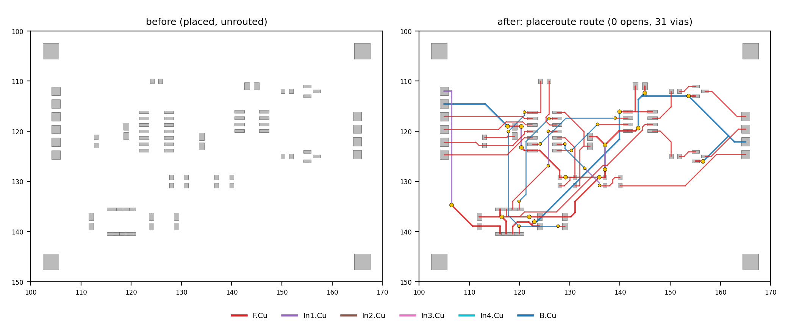

# copperpath

Rule-aware routability check, placement helper and grid router for **already-placed KiCad boards**,
written in Rust (parallel with rayon). It reads the board, the net classes (`.kicad_pro`) and the
custom rules (`.kicad_dru`) directly, routes signal nets with exact clearance checks and writes the
result back as ordinary KiCad tracks and vias.

**Status: research prototype.** Tested on KiCad 10 boards (4 and 6 copper layers). HV/power pours
and plane nets are not routed. Expect rough edges; see [Limitations](#limitations) and
[ROADMAP.md](ROADMAP.md).



## Build

Requires a recent stable Rust toolchain (developed with 1.95).

```bash
cargo build --release          # binary: target/release/copperpath
cargo test --release           # unit tests + routing of the demo board
```

Optional: KiCad 10's `kicad-cli` for the DRC comparison (`route --drc`). It is found via
`--kicad-cli PATH`, else `$KICAD_CLI`, else `kicad-cli` on the `PATH`.

## Quickstart (demo board)

`examples/demo/` holds a small synthetic 4-layer board (25 parts, 24 nets, one rule area, two net
classes, three custom rules), placed but not routed.

```bash
B=target/release/copperpath
$B route --pcb examples/demo/demo.kicad_pcb --out out/demo_routed.kicad_pcb --threads 4
#   [route] 24 nets, 50 connections: 181 segments (601 mm), 31 vias ... 0 opens
$B route --pcb examples/demo/demo.kicad_pcb --out out/demo_routed.kicad_pcb --drc --json
#   {"ok": true, "opens": 0, "vias": 31, "drc": {"new_errors": 0, ...}, ...}
$B check --pcb examples/demo/demo.kicad_pcb --out out/check     # routability report + PNG maps
$B hints --pcb examples/demo/demo.kicad_pcb                      # placement hints
```

Open `out/demo_routed.kicad_pcb` in KiCad. The input board is never modified.

## Commands

All commands take `--pcb BOARD.kicad_pcb`. Common options:

| option | meaning |
|---|---|
| `--cfg config.json` | optional board configuration (see `examples/config.json`) |
| `--board NAME` | entry under `"boards"` in the config (default: the first) |
| `--pro F` / `--dru F` | project / custom rules file (default: next to the board) |
| `--threads N` | worker threads (default: all cores) |
| `--json` | one JSON result object on stdout; logs stay on stderr |
| `--version` | version and git hash |

| command | job |
|---|---|
| `route [--region x0,y0,x1,y1] [--nets PATTERNS] --out OUT.kicad_pcb [--delta-json DELTA.json] [--drc]` | Detailed router (below). Routes every routable net whose pads lie in the region (default: whole board). Appends unlocked tracks/vias to a copy and writes `OUT_route.json`; `--delta-json` writes the added/removed items in nm for the KiCad IPC API ([schema](#change-set-for-the-kicad-ipc-api---delta-json)). `--drc` runs `kicad-cli` on input and output and reports the new violations. |
| `check [--out DIR] [--res 0.25] [--tile 1.0] [--copper locked\|all] [--crop x0,y0,x1,y1 --crop-class C]` | Routability report: via-site maps per net class, region analysis per schematic sheet, what-if ablation (without rule areas, via keepouts, locked copper), global route with congestion per tile and layer, hotspot list. Writes `report.json`, `groute.json`, `congestion.json` and PNG maps. |
| `place --zones zones.json [--init keep\|schematic\|both] [--moves N] [--starts K] [--out DIR]` | Parallel simulated-annealing placement of the movable parts inside zones (see `examples/zones.json`). Writes `place.json`; apply it to a copy with `scripts/apply_place.py`. |
| `opens [--region] [--nets]` | Unconnected connections per net, counted from all copper (no 499-item cap as in kicad-cli). |
| `hints [--region] [--nets] [--tol 1.0]` | Pad pairs of a net that are *almost* in one row or column (offset 0.02..tol mm). Each forces a jog between two straight pad exits; align the pads before routing. |
| `pads` | Pad world positions, sizes and nets (tab separated). |
| `netclass` | net → net class table (tab separated). |

`--nets` takes comma-separated wildcards (`*`, `?`), e.g. `--nets "/Driver/*,+5V"`.

### Route options

| option | default | meaning |
|---|---|---|
| `--res` | 0.05 | grid resolution in mm |
| `--via-cost` | 30 | via cost (in grid steps) |
| `--bend-cost` / `--bend90` | 4 / 1.4 | cost of a 45° bend / factor for 90° bends |
| `--hweight` | 1.02 | A\* heuristic weight (>1: faster, less optimal) |
| `--max-expand` | 4e6 | node budget per search (at least half the nodes of the net's window) |
| `--iters` | 25 | negotiation iterations |
| `--job-margin` | 6 | per-net search window margin in mm |
| `--time-limit S` | | stop negotiating in time and write the best iteration so far (conflicting nets ripped and rerouted, or left as failed); SIGTERM / Ctrl+C (Ctrl+Break on Windows) do the same at once. `--json` reports `stopped` (`time-limit`, `signal`, `cancel`) and `hotspots` (net, conflict cells, location, layer) |
| `--cancel-file PATH` | | stop like `--time-limit` as soon as this file exists (checked once per second); a cancel path that also works on Windows, where a GUI can only kill the process otherwise. The file should not exist at the start |
| `--cancel-on-stdin-eof` | | stop like `--time-limit` when stdin is closed, e.g. because the calling plugin or KiCad ended |
| `--stall-iters` | 3 | stop negotiating after this many iterations without fewer conflict cells, then rip up and reroute the conflicting nets |
| `--par-nets` | 1 | 1 = nets whose windows cannot interact route in parallel (same result as serial); N > 1 = blocks of N nets against one snapshot (experimental) |
| `--par-conn` | 1 | experimental: parallel connection searches inside a multi-pin net (0 = all threads); slower on the benchmark boards so far |
| `--no-stubs` / `--no-clean` | | disable straight pad exits / the cleanup |
| `--stub-ext` / `--stub-ext-long` | 0.6 / 0.6 | exit stub length beyond the pad (mm) |
| `--own-pad-cost` / `--stub-side-cost` | 40 / 20 | cost of crossing own pads / of side exits on long pads |
| `--yield-pours PATTERNS` | | locked pours (zone name wildcards) that do not block (KiCad refills them); also `yield_pours` in the config |
| `--ignore-unlocked` | | ignore unlocked tracks/vias of the input (old behaviour; by default all existing copper blocks other nets) |
| `--dbg-net NAME` | | verbose trace of one net |

## How routing works

- **Model.** Grid of 0.05 mm cells on every copper layer of the board, 8 directions plus through
  vias. Legality is exact at cell centres: a track centre may sit in a cell when its half width
  plus the clearance from the net-pair matrix (net classes + DRU rules, outer/inner layer
  conditions, hole clearances, rule areas, board edge) keeps it off every foreign object; touching
  the clearance exactly is legal, as in KiCad's DRC. Solder mask apertures on the outer layers
  (F/B.Mask graphics, pad mask expansions from the pad, footprint or `pad_to_mask_clearance`) admit
  only the nets of the pads and locked zones inside them, so no copper of another net is exposed
  next to a pad (KiCad `solder_mask_bridge`). Tracks use the DRU/net-class optimal width; within
  1.5 mm of own pads the minimum width is allowed (neck-down for fine pitch). The grid is shifted
  by less than one cell so that the axes of the tightest pin rows lie on cell centres (a 0.2 mm
  track between 0.2 mm pads at 0.4 mm pitch fits only exactly on the pad axis).
- **Search.** Windowed multi-target A\* per net; nets are routed in parallel per iteration.
- **Negotiation.** PathFinder-style congestion costs (present × occupancy + history), stall
  detection, then rip-up of the most conflicted nets and a hard reroute.
- **Verification.** All routed copper is checked exactly against fixed objects and other nets
  before writing; a failed check is reported (`aes.exact_fail`), never silently written.

### Aesthetics rules (on by default)

- **Straight pad exits.** Each pad gets precomputed exit stubs per layer and pad axis, running from
  the pad centre along the axis to half extent + 0.6 mm. Long pads (aspect ≥ 1.2) exit along the
  long axis whenever that is legal. Where no full stub fits, a short stub (0.12–0.4 mm beyond the
  pad) is used and counted (`aes.short_stubs`).
- **45° only.** Tracks are octilinear; no turns sharper than 90°; 45° bends are cheaper than 90°.
  A final polish replaces slightly off-angle segments by small axis jogs (`aes.axis_jogs`).
- **Exact cleanup.** Stub alignment, octilinear pull-tight with 1–3 segment links, jog merge,
  stub-end and junction sliding (never into pads), via slide onto the stub axis, 45° mitering of
  90° corners, removal of tiny junction legs. Every change is re-checked against the rules and the
  other nets, so the cleanup cannot add DRC errors. Kept 90° corners are reported by cause
  (`aes.kept90_by_cause`).
- **Fallback ladder.** If the cleanup costs completeness (a net loses a connection), the router
  reruns without sliding (`no-slide`), then without cleanup (`no-clean`). The level used is in
  `aes.cleanup_level`.

`hints` finds the placement-side cause of many ugly jogs: two pads of a net that are almost, but not
exactly, aligned. Fix those in the placement and the exits connect with one straight track.

## Board configuration

`--cfg` is optional. `examples/config.json` documents the keys: nets/classes to skip, plane nets,
footprints whose courtyard forbids vias, allowed layers per net class, preferred layer directions
for the global router, mounting-hole pattern. Keys may be per board under `"boards"`.

## Using copperpath from scripts/AI agents

Every command accepts `--json`. It then prints exactly **one JSON object** to stdout; human-readable
logs go to stderr. Exit codes: `0` success, `1` error in a known command (bad file, bad option,
kicad-cli failure), `2` unknown or missing command.

Common fields: `ok`, `command`, `version`, `threads`, `total_s`, `warnings`. On error:
`{"ok": false, "command": ..., "error": "...", "version": ...}`.

`route --json` (also written to `OUT_route.json`):

```json
{
  "ok": true, "command": "route", "version": "0.1.0 (abc12345)",
  "nets": 24, "connections": 50, "opens": 0, "open_nets": [], "failed": [],
  "segments": 181, "vias": 31, "length_mm": 601.39, "routes": 43, "rips": 2,
  "search_s": 2.98, "total_s": 6.66, "threads": 4, "out": "out/demo_routed.kicad_pcb",
  "aes": { "cleanup_level": "full", "exact_fail": 0, "stub_ends": 88, "short_stubs": ["U1.3"],
           "pins_no_stub": [], "mitered": 3, "kept90_by_cause": {...}, "axis_jogs": 17, ... },
  "drc": { "violations_before": 0, "violations_after": 0, "new_violations": 0, "new_errors": 0,
           "new": [], "unconnected_before": 50, "unconnected_after": 0, "reports": [...] },
  "warnings": []
}
```

Suggested agent loop: `hints` → fix placement → `route --drc --json` → accept if `ok`, `opens == 0`
and `drc.new_errors == 0`, else inspect `open_nets`, `drc.new` and `aes` and adjust nets, region
or options. Keep the input board read-only; always route into a new file.

### Change set for the KiCad IPC API (`--delta-json`)

`route --delta-json DELTA.json` writes what the run changed, so an editor plugin can apply it as
one commit (`begin_commit`, `remove_items` / `create_items`, `push_commit`) instead of reloading a
file. It works together with `--out` or instead of it (without `--out` no board file and no
`OUT_route.json` are written; `--drc` needs `--out`). `--delta-json -` prints the delta to stdout
(not together with `--json`). `--pcb -` reads the board text from stdin; give `--pro` / `--dru`
explicitly then (stdin is read to the end, so cancel with `--cancel-file`, not
`--cancel-on-stdin-eof`). The `--json` result reports `delta_json` (path) and `out` (`null` without `--out`).

```json
{"v": 1, "units": "nm",
 "remove": ["<uuid>"],
 "add": [{"type": "track", "net": "SDA", "layer": "F.Cu", "width": 150000, "start": [0, 0], "end": [0, 0]},
         {"type": "arc", "net": "SDA", "layer": "F.Cu", "width": 150000, "start": [0, 0], "mid": [0, 0], "end": [0, 0]},
         {"type": "via", "net": "GND", "at": [0, 0], "size": 600000, "drill": 300000,
          "layers": ["F.Cu", "B.Cu"], "via_type": "through"}]}
```

- All lengths and coordinates are integer nanometres (KiCad's internal unit), so nothing is lost
  to rounding; `v` is the schema version.
- `remove`: UUIDs of input items that were ripped up or replaced. `route` keeps all existing
  copper today, so the list is empty; the field is there for the incremental modes.
- `add`: new items in output order. The router emits `track` and through `via` items; `arc` is
  part of the schema for later cleanup steps.
- Applying the delta to the input board (`copperpath::delta::apply`) gives the same copper as
  `--out` (tested on the demo: same tracks and vias within 1 nm, same opens).

## Comparison with Freerouting

Freerouting is the established open-source autorouter for KiCad (via Specctra DSN). An informal
comparison on one region of a 6-layer mixed-signal board (46 nets, 90 connections, 4 threads,
same placed input):

| | copperpath | Freerouting (60 s budget) | Freerouting (full run, ~5 min) |
|---|---|---|---|
| connections routed | 90 / 90 | 83 / 90 | 81 / 90 |
| new KiCad DRC errors | 0 | clearance errors (rules not in DSN) | dangling tracks |
| wall time | 5–15 s | 50 s | ~300 s |
| vias | ~28 | 9 | 9 |

- copperpath reads the KiCad rules directly (DRU conditions such as outer-layer-only clearances
  or rule areas), so it does not lose rules in the DSN export, and it is fast and parallel.
- Freerouting uses far fewer vias, produces somewhat shorter tracks, has years of polish and
  handles many more cases (differential pairs, more board types). After its optimisation passes
  its geometry is often cleaner in open areas.
- One board is not a benchmark. Measure on your own boards (the demo is a starting point).

## Limitations

- Copper layers are indexed as a 6-layer stack (`F.Cu`, `In1..In4.Cu`, `B.Cu`); boards with more
  inner layers are not supported. Boards with fewer layers work (missing layers are masked out; tested with 4 layers).
- Plane nets, pours and high-current/HV nets are not routed (skip them via the config); existing
  zones are obstacles (locked) or ignored (unlocked or listed in `yield_pours`, refilled later by
  KiCad). Existing tracks and vias, locked or not, are kept and block other nets.
- DRU conditions that depend on position (`intersectsCourtyard`, `insideArea`) are not evaluated.
- Through vias only; no differential pairs, no length tuning; DRU max-length rules are only used by
  `place`.
- Very long multi-pin nets are slow (millions of nodes per search); restrict with `--region`/`--nets`.
- Panels with several board outlines must be split first.
- KiCad 6 or newer board files only; open and save older boards in KiCad first.
- Uses more vias than Freerouting; tune `--via-cost` and `class_layers`.
- Legality is exact at grid cell centres; off-grid pad centres are reached by stubs and verified
  exactly, but rare edge cases can still show up in KiCad DRC. Always run `--drc`.

## Scripts

| script | needs | job |
|---|---|---|
| `scripts/make_demo.py [OUT_DIR]` | KiCad 10 Python (`pcbnew`), KiCad footprint library | regenerate the demo board |
| `scripts/apply_place.py IN place.json OUT` | KiCad 10 Python (`pcbnew`) | apply a `place` result to a copy |
| `scripts/plot_route.py OUT.png x0,y0,x1,y1 TITLE=B.kicad_pcb ...` | Python 3, matplotlib | side-by-side copper plots |
| `scripts/drc_compare.py base.json new.json` | Python 3 | diff two kicad-cli DRC reports |
| `scripts/release.sh [--no-latest]` | bash, git, cargo | build, test, copy the binary to `$COPPERPATH_RELEASE_DIR` |

Run the `pcbnew` scripts with KiCad's bundled Python (e.g. on macOS
`/Applications/KiCad/KiCad.app/Contents/Frameworks/Python.framework/Versions/Current/bin/python3`).

## KiCad plugin

[`kicad-plugin/`](kicad-plugin/README.md) adds a **Route with copperpath** button to the KiCad
9/10 PCB editor (IPC API). It routes the open board and pushes the result as one commit, so one
Ctrl+Z undoes it and no file is reloaded.

## Contributing and issues

See [CONTRIBUTING.md](CONTRIBUTING.md). Report bad results with the "Bad routing result" issue
template and a **synthetic** repro board, never with proprietary board data.

## License

Licensed under either of

- Apache License, Version 2.0 ([LICENSE-APACHE](LICENSE-APACHE))
- MIT license ([LICENSE-MIT](LICENSE-MIT))

at your option. Unless you explicitly state otherwise, any contribution intentionally submitted
for inclusion in this work, as defined in the Apache-2.0 license, shall be dual licensed as above,
without any additional terms or conditions. Third-party licenses: [THIRD_PARTY.md](THIRD_PARTY.md).
